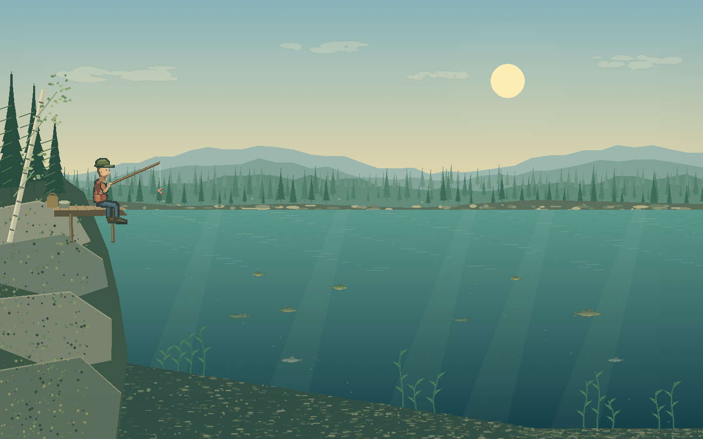
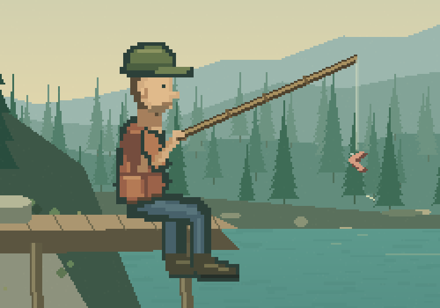
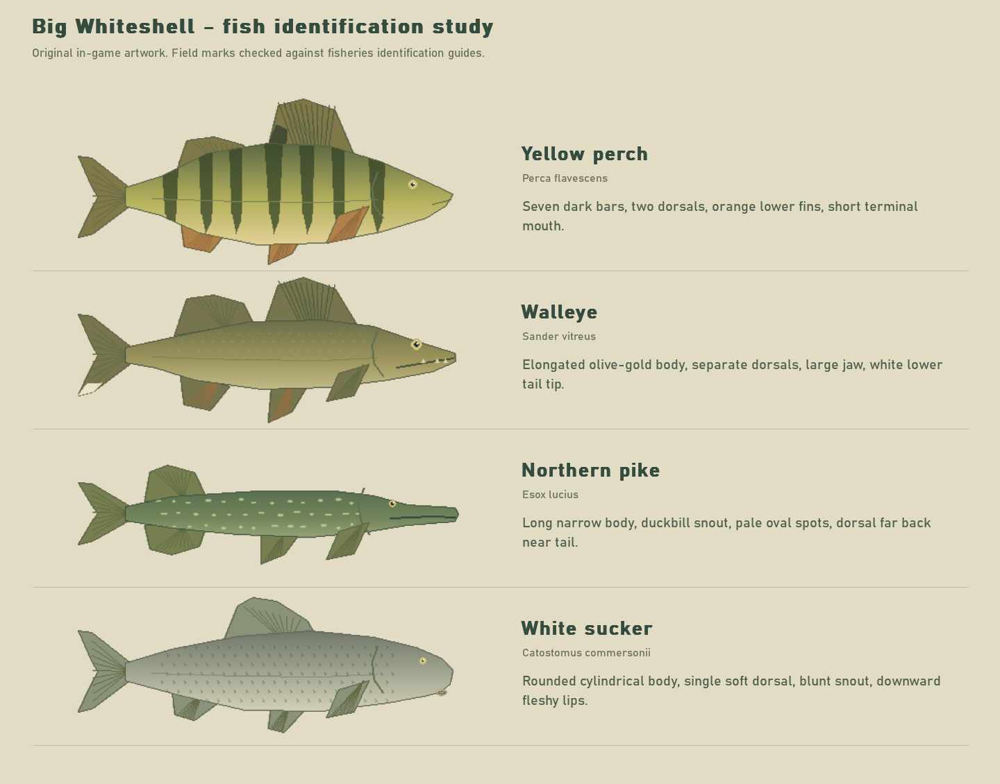

# Little Tides

A standalone 2D fishing game set on the shore of Big Whiteshell Lake in Manitoba. The first prototype focuses on a simple kit: a stick, six metres of tied line, a bare hook, and a worm.



[Download the latest Windows and Mac builds](https://github.com/matt872000/little-tides/releases/latest). See [changes](CHANGELOG.md) for fixes in each version.

## Current playable build

- Cast with a flick of the stick, let the hooked worm sink, and gather line by hand.
- A fixed-step flexible rope models slack, while gravity, buoyancy and quadratic drag affect the hook and worm.
- Respond to a nibble, set the hook, manage a fish's runs, land it, measure it, and release it.
- Four native starter species: yellow perch, walleye, northern pike, and white sucker. Bait interest differs by species; pike ignore the starting worm in this model.
- Local catch records and Manitoba Master Angler achievements. Future records are keyed by species and region.
- Full-window lake view, a notebook journal, optional control hints, and a keyboard-accessible pause menu.

This is an early prototype with stylized art and estimated physics parameters, ready for playtesting and iteration. Boats, coolers, bobbers, other baits, specialist methods, travel and game licenses remain planned features.

## Run from source

Use Python 3.12 on Windows:

```powershell
python -m venv .venv
.\.venv\Scripts\python -m pip install -r requirements.txt
.\.venv\Scripts\python main.py
```

On macOS, create the environment with `python3 -m venv .venv`, then use `.venv/bin/python` for the install and run commands. The packaged desktop game runs offline without a browser, account, or Python installation. Keep the Windows `_internal` folder beside its executable; the Mac package contains `Little Tides.app`.

## Controls

| Input | Action |
| --- | --- |
| Hold and release left click over the lake | Cast |
| Left click or Space on a nibble | Set the hook |
| Hold Space or right click | Gather line by hand |
| W / S, Up / Down, mouse wheel | Lift or lower the stick |
| J | Open or close the journal |
| Esc / H | Pause and controls |
| F1 | Toggle control hints |
| F11 | Toggle fullscreen |
| M | Toggle sound |
| Enter on the catch screen | Release the fish |

## Build a Windows executable

```powershell
.\build.ps1
```

The script uses the project virtual environment and writes `dist/Little Tides/Little Tides.exe`. Distribute the complete game folder. See [BUILD.md](BUILD.md) for manual build and offscreen smoke-test commands.

## Windows and Mac releases

Every version is released with three native downloads: Windows x64, Mac Apple Silicon (arm64), and Mac Intel (x64). The [Desktop releases workflow](.github/workflows/release.yml) runs checks, builds on each native operating system, renders a frame from each packaged executable, and verifies the package checksums before publishing one complete GitHub Release.

To publish a version, use **Actions → Desktop releases → Run workflow** and enter a version such as `v0.1.0`, or push a new `v*` version tag. Published versions are immutable; use a new version number for later changes. The release does not publish if any platform build fails.

Native packages can also be built locally after installing the requirements:

```text
python build_release.py --version v0.1.0
```

Run that command on Windows for Windows, on an Apple Silicon Mac for arm64, or on an Intel Mac for x64. Mac builds are initially ad-hoc signed and **not Developer ID signed or notarized**; macOS may require approval in Privacy & Security. Developer ID signing and notarization can be added when Apple signing credentials are available.

## Checks

```powershell
.\.venv\Scripts\python check_game.py
.\.venv\Scripts\python natural_play_check.py
.\.venv\Scripts\python check_presentation.py
.\.venv\Scripts\python check_regressions.py
```

The first three checks run with SDL's offscreen driver. `check_regressions.py` also checks fish compositing in a hidden native window, including macOS's Cocoa driver. Water-entry checks catch surface skipping and bottom bounce. Every release checks the packaged application on its native window driver. Interactive input still needs manual playtesting.

## Project files

| File | Purpose |
| --- | --- |
| `main.py` | Application loop, fishing state machine, input and portable saves |
| `physics.py` | Flexible line and hook/worm forces |
| `presentation.py` | Lake scene, HUD, pause menu and notebook |
| `angler_art.py` | Original pixel-grid angler |
| `fish_art.py` | Species-specific anatomy, fins and markings |
| `data.py` | Fish and future region data; only the starter lake is active |
| `preview_art.py` | Render asset close-ups for visual review |

During development, progress is saved beside `main.py`. The packaged Windows game saves beside its executable. The Mac app saves in `~/Library/Application Support/Little Tides/`, so its application bundle can remain read-only. Player saves, runtime libraries and compiled builds are excluded from Git.

## Art and future direction





The sprites are original artwork encoded in source. Field marks were checked against fisheries identification guides; [research sources](docs/SOURCES.md) document the references. The [design notes](docs/GAME_DESIGN.md) preserve the equipment, exploration and regional achievement plans.

Third-party dependency notices are in [THIRD-PARTY.txt](THIRD-PARTY.txt) and `licenses/`. No license granting rights to the original game code or artwork has been selected yet.
